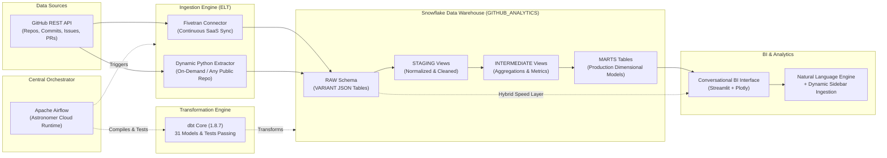

# 📖 GitHub Developer Ecosystem Analytics: The Project Bible
**Author:** Tanvi Vinayak Jagade (with Riya)  
**Project Repository:** [haze-helloworld/DE-MICROPROJECT](https://github.com/haze-helloworld/DE-MICROPROJECT)  
**Date:** November 2026  
**Architecture:** Modern Data Stack (MDS) — Airflow + Fivetran + Snowflake + dbt + Streamlit  

---

## 📑 Table of Contents
1. [Executive Summary & Purpose](#1-executive-summary--purpose)
2. [High-Level Architecture & Tech Stack](#2-high-level-architecture--tech-stack)
3. [Component Deep-Dive: Why We Chose Each Tool](#3-component-deep-dive-why-we-chose-each-tool)
   - [3.1 Data Ingestion: Fivetran & Dynamic REST Extractor](#31-data-ingestion-fivetran--dynamic-rest-extractor)
   - [3.2 Data Warehouse: Snowflake](#32-data-warehouse-snowflake)
   - [3.3 Transformation Layer: dbt (Data Build Tool)](#33-transformation-layer-dbt-data-build-tool)
   - [3.4 Orchestration: Apache Airflow (Astronomer Cloud)](#34-orchestration-apache-airflow-astronomer-cloud)
   - [3.5 BI & User Interface: Conversational BI (Streamlit & Plotly)](#35-bi--user-interface-conversational-bi-streamlit--plotly)
4. [End-to-End Data Flow & Lifecycle](#4-end-to-end-data-flow--lifecycle)
5. [Database Schema & Dimensional Modeling Design](#5-database-schema--dimensional-modeling-design)
6. [Security & Authentication Architecture](#6-security--authentication-architecture)
7. [Key Architectural Decisions & Design Patterns](#7-key-architectural-decisions--design-patterns)
8. [Codebase Map & File Guide](#8-codebase-map--file-guide)
9. [Operations Runbook (Local, Docker & Cloud)](#9-operations-runbook-local-docker--cloud)
10. [Viva & Evaluation Defense (Q&A Cheat Sheet)](#10-viva--evaluation-defense-qa-cheat-sheet)

---

## 1. Executive Summary & Purpose

### The Mission
Open-source software powers modern technology infrastructure. However, engineering leaders, developer advocates, and OSS maintainers lack unified, real-time analytical visibility into developer velocity, repository health, community engagement, and issue resolution lifecycle across distinct open-source ecosystems.

### The Solution
We designed and built an enterprise-grade **Modern Data Stack (MDS)** data pipeline and **Conversational BI Interface** that:
1. Ingests rich software engineering metadata from GitHub (repositories, commits, pull requests, issues, and programming language statistics).
2. Automates raw loading into a cloud data warehouse (**Snowflake**) with zero plaintext passwords (2048-bit RSA key-pair authentication).
3. Transforms unstructured JSON variant data into clean, dimensional data marts using **dbt Core** (medallion architecture: staging, intermediate, marts) guarded by 19 automated schema and referential integrity tests.
4. Orchestrates the workflow end-to-end using **Apache Airflow** on Astronomer Cloud.
5. Surfaces natural-language conversational queries and real-time dynamic repository ingestion via a public **Streamlit Community Cloud** application.

---

## 2. High-Level Architecture & Tech Stack



---

## 3. Component Deep-Dive: Why We Chose Each Tool

### 3.1 Data Ingestion: Fivetran & Dynamic REST Extractor
* **Why Fivetran?**
  * **Managed ELT:** Fivetran handles schema evolution, connector health, rate-limiting backoffs, and OAuth token refreshes automatically without infrastructure overhead.
  * **Zero Maintenance:** Syncs managed internal/organization repositories directly into Snowflake using key-pair authentication.
* **Why the Dual Extractor (`ingestion/extractor.py`)?**
  * **Bypassing SaaS Boundary Limits:** Fivetran scopes repository ingestion to the authenticated GitHub organization. To track external, arbitrary open-source projects (`apache/airflow`, `facebook/react`, `tensorflow/tensorflow`, `golang/go`, `rust-lang/rust`) or allow users to ingest any GitHub URL dynamically from the web UI, our custom paginated Python extractor bridges the gap.
  * **Staging & Bulk Loading:** Uses Snowflake's internal stage (`@%TABLE`) and `COPY INTO` with `MATCH_BY_COLUMN_NAME` for fast bulk JSON loading rather than slow individual `INSERT` statements.

### 3.2 Data Warehouse: Snowflake
* **Account:** `IWQNQNR-IJ38491` | **Warehouse:** `GH_WH` (XSMALL, 60s auto-suspend)
* **Why Snowflake?**
  * **Native Semi-Structured Data Support:** GitHub payloads contain nested JSON objects. Snowflake's `VARIANT` data type allows ingesting arbitrary JSON without upfront schema definition, while colon syntax (`payload:author.login::string`) enables high-speed querying using columnar performance.
  * **Decoupled Storage and Compute:** Storage (`GITHUB_ANALYTICS`) scales independently from compute (`GH_WH`). When no queries are active, the warehouse auto-suspends after 60 seconds, consuming 0 compute credits.
  * **Granular Role-Based Access Control (RBAC):** We created dedicated functional roles (`INGEST_ROLE`, `TRANSFORM_ROLE`, `BI_ROLE`) enforcing the Principle of Least Privilege.

### 3.3 Transformation Layer: dbt (Data Build Tool)
* **Why dbt Core?**
  * **Software Engineering Best Practices for SQL:** Modular data modeling (`ref()`), version-controlled schemas, automated dependency DAG generation, and built-in environment isolation (`dev` vs `prod`).
  * **Medallion Architecture:**
    1. **Staging (`STAGING`):** Extracts raw JSON into typed relational columns, normalizes timestamps to UTC, and cleans casing.
    2. **Intermediate (`INTERMEDIATE`):** Pre-calculates lifecycle statistics (e.g., issue resolution times, PR merge rates, monthly commit velocity).
    3. **Marts (`MARTS`):** Materializes wide, highly indexed dimensional tables (`dim_repository`, `mart_developer_activity`, `mart_issue_resolution`, `mart_language_activity`) optimized for sub-second analytical queries.
  * **Automated Data Quality Assurance:** 19 automated tests (uniqueness, non-nullability, accepted values) run on every build to guarantee zero bad data enters production marts.

### 3.4 Orchestration: Apache Airflow (Astronomer Cloud)
* **DAG ID:** `github_analytics_pipeline` | **Schedule:** `0 0 * * *` (Daily)
* **Why Apache Airflow?**
  * **Directed Acyclic Graphs (DAGs) as Code:** Workflows are written in Python, enabling dynamic generation, parameters, and version control.
  * **Enterprise Reliability:** Automated retries (2 retries, 5-minute backoff), task SLA monitoring, visual dependency tracing, and task logs.
  * **Astronomer (Astro Runtime 3.3-12):** Provides production cloud hosting without managing Kubernetes clusters or local Docker daemons.

### 3.5 BI & User Interface: Conversational BI (Streamlit & Plotly)
* **Why Streamlit?**
  * **Interactive Python BI:** Native data science integration with Pandas and Plotly without requiring heavyweight legacy BI servers.
  * **Conversational Natural Language Interface:** Users ask plain-English questions ("Show commit velocity", "Which languages have the most stars?"), and the engine translates intent into optimized Snowflake SQL queries with interactive visualizations.
  * **Dynamic UI Ingestion:** Engineering leaders can add any public repository directly from the sidebar; the app triggers ingestion into Snowflake on the fly.

---

## 4. End-to-End Data Flow & Lifecycle

```
[GitHub API]
     │
     ▼ (1. Batch / On-Demand Extraction)
[Snowflake Internal Stage]
     │
     ▼ (2. COPY INTO RAW schema)
[RAW.REPOSITORIES | COMMITS | ISSUES | PULL_REQUESTS | REPO_LANGUAGES]
     │
     ▼ (3. dbt Staging: stg_*)
[STAGING Views: Type Casting, JSON Unnesting, ISO 8601 UTC Parsing]
     │
     ▼ (4. dbt Intermediate: int_*)
[INTERMEDIATE Views: Aggregations, DATEDIFF resolution hours, Merge %]
     │
     ▼ (5. dbt Marts: dim_* & mart_*)
[MARTS Tables: Materialized Star-Schema for Sub-Second Analytics]
     │
     ├─────────────────────────────────┐
     ▼                                 ▼ (Hybrid Speed Layer)
[Conversational BI (Streamlit)] <──────┘
     │
     ▼ (Natural Language Response + Interactive Plotly Charts)
[End-User / Engineering Leader]
```

---

## 5. Database Schema & Dimensional Modeling Design

### 5.1 Storage Layer: `GITHUB_ANALYTICS.RAW`
Stores unmodified source payloads inside `VARIANT` columns alongside audit metadata:
* **`REPOSITORIES`**: `(payload VARIANT, ingested_at TIMESTAMP_TZ)`
* **`COMMITS`**: `(payload VARIANT, repo VARCHAR, ingested_at TIMESTAMP_TZ)`
* **`ISSUES`**: `(payload VARIANT, repo VARCHAR, ingested_at TIMESTAMP_TZ)`
* **`PULL_REQUESTS`**: `(payload VARIANT, repo VARCHAR, ingested_at TIMESTAMP_TZ)`
* **`REPO_LANGUAGES`**: `(payload VARIANT, repo VARCHAR, ingested_at TIMESTAMP_TZ)`

### 5.2 Staging Layer: `GITHUB_ANALYTICS.STAGING` (Views)
* `stg_repositories`: Normalizes repo IDs, star counts, forks, watchers, open issue counts, primary language, and creation timestamps.
* `stg_commits`: Normalizes commit SHAs, author logins, committer names, and commit timestamps.
* `stg_issues`: Normalizes issue numbers, states (`open`/`closed`), titles, created/closed timestamps, and calculates `resolution_hours`.
* `stg_pull_requests`: Normalizes PR numbers, states, merge timestamps, lines added/deleted, and calculates `merge_time_hours`.
* `stg_repo_languages`: Normalizes language byte breakdowns per repository.

### 5.3 Intermediate Layer: `GITHUB_ANALYTICS.INTERMEDIATE` (Views)
* `int_commits_by_repo_month`: Month-by-month commit velocity and active contributor count per repo.
* `int_issue_resolution`: Per-repo issue metrics: total, open, closed, median and average resolution hours.
* `int_pr_lifecycle`: PR cycle metrics: total PRs, merge rate %, average merge time, and average code churn (lines changed).

### 5.4 Production Data Marts: `GITHUB_ANALYTICS.MARTS` (Physical Tables)
* **`dim_repository`**: Central repository dimension table containing complete ecosystem statistics, star rank, commit count, and active status.
* **`mart_developer_activity`**: Contributor leaderboard detailing total commits, distinct repos contributed to, and activity tenure (first and last commit dates).
* **`mart_issue_resolution`**: Service-level metric mart tracking issue handling velocity across open-source maintainer teams.
* **`mart_language_activity`**: Macro-level programming language adoption mart aggregating star shares and repository counts across technologies.

---

## 6. Security & Authentication Architecture

### 6.1 Zero-Password RSA Key-Pair Authentication
Passwords in configuration files represent severe security vulnerabilities. Our architecture enforces **asymmetric 2048-bit RSA key-pair cryptography**:
1. Generated encrypted private key `rsa_key.p8` and public key `rsa_key.pub`.
2. Assigned the public key directly to service users in Snowflake:
   ```sql
   ALTER USER SVC_INGEST SET RSA_PUBLIC_KEY='MIIBIjANBgkqhki...';
   ```
3. Extracted DER private bytes in memory during Python runtime (`cryptography.hazmat.primitives`) to sign JWT authentication tokens.

### 6.2 Role-Based Access Control (RBAC) Matrix

| Snowflake Role | Member Service User | Permitted Privileges | Purpose |
| :--- | :--- | :--- | :--- |
| **`INGEST_ROLE`** | `SVC_INGEST` | `USAGE ON WAREHOUSE GH_WH`<br/>`ALL ON SCHEMA GITHUB_ANALYTICS.RAW`<br/>`CREATE SCHEMA ON DATABASE GITHUB_ANALYTICS` | Ingestion engine writes raw JSON into Snowflake and creates Fivetran schemas. |
| **`TRANSFORM_ROLE`** | `SVC_DBT` | `USAGE ON WAREHOUSE GH_WH`<br/>`SELECT ON SCHEMA RAW`<br/>`CREATE SCHEMA ON DATABASE GITHUB_ANALYTICS` | dbt creates and compiles staging, intermediate, and marts schemas. |
| **`BI_ROLE`** | `SVC_BI` / Web App | `USAGE ON WAREHOUSE GH_WH`<br/>`USAGE ON SCHEMA MARTS`<br/>`SELECT ON ALL TABLES IN MARTS` | Read-only access for analytics dashboard. Cannot alter schemas or write data. |

---

## 7. Key Architectural Decisions & Design Patterns

### Decision 1: ELT over Traditional ETL
* **Choice:** Extract ➔ Load ➔ Transform (ELT).
* **Rationale:** Traditional ETL requires heavy transformation servers before loading into the warehouse. With Snowflake's elastic cloud compute and `VARIANT` type, loading raw JSON first preserves all historical data fidelity. If analytical business logic changes tomorrow, we re-run dbt models over the raw data without re-fetching from GitHub.

### Decision 2: Why dbt Doesn't Rerun on Every User Click (Lambda Hybrid Pattern)
* **Question:** *"Should dbt rerun synchronously when a user clicks 'Add Repo' in the UI?"*
* **Architectural Rationale:** **No.** Running `dbt run` on every click burns warehouse credits, introduces 30-second latency to web users, and risks breaking production models if dirty data enters.
* **Our Solution (Hybrid Speed/Batch Serving):**
  * **Batch Layer:** Airflow triggers `dbt build` on a scheduled cadence to build tested, high-performance `MARTS`.
  * **Speed Layer:** The Streamlit BI app uses a `UNION ALL` query that serves from `MARTS` while including un-transformed records from `RAW` in real time.

### Decision 3: Decoupled Multi-Container Cloud Architecture
* **Astronomer Cloud:** Dedicated Python 3.12+ execution environment with pinned Airflow providers.
* **Streamlit Cloud:** Dedicated web hosting container reading secrets securely via `st.secrets`.
* **Shared Contract:** The Snowflake warehouse serves as the single source of truth connecting all microservices.

---

## 8. Codebase Map & File Guide

| Path | Description |
| :--- | :--- |
| [`dags/github_pipeline_dag.py`](file:///c:/Users/TANVI/OneDrive/Desktop/DE_MICROPROJECT/DE-MICROPROJECT/dags/github_pipeline_dag.py) | Apache Airflow production DAG orchestrating ingest, dbt deps, dbt run, and dbt test. |
| [`ingestion/extractor.py`](file:///c:/Users/TANVI/OneDrive/Desktop/DE_MICROPROJECT/DE-MICROPROJECT/ingestion/extractor.py) | Paginated GitHub REST API extractor fetching repos, commits, issues, PRs, and languages into Snowflake internal stage. |
| [`ingestion/repos.txt`](file:///c:/Users/TANVI/OneDrive/Desktop/DE_MICROPROJECT/DE-MICROPROJECT/ingestion/repos.txt) | Seed file containing monitored repositories. |
| [`dbt_project/dbt_project.yml`](file:///c:/Users/TANVI/OneDrive/Desktop/DE_MICROPROJECT/DE-MICROPROJECT/dbt_project/dbt_project.yml) | dbt configuration file defining schemas, materialization rules, and project metadata. |
| [`dbt_project/models/staging/`](file:///c:/Users/TANVI/OneDrive/Desktop/DE_MICROPROJECT/DE-MICROPROJECT/dbt_project/models/staging/) | 5 staging views normalizing raw JSON variants into typed SQL schemas. |
| [`dbt_project/models/intermediate/`](file:///c:/Users/TANVI/OneDrive/Desktop/DE_MICROPROJECT/DE-MICROPROJECT/dbt_project/models/intermediate/) | 3 intermediate views computing metrics like issue resolution hours and PR merge %. |
| [`dbt_project/models/marts/`](file:///c:/Users/TANVI/OneDrive/Desktop/DE_MICROPROJECT/DE-MICROPROJECT/dbt_project/models/marts/) | 4 production data marts (`dim_repository`, `mart_developer_activity`, etc.). |
| [`bi/app.py`](file:///c:/Users/TANVI/OneDrive/Desktop/DE_MICROPROJECT/DE-MICROPROJECT/bi/app.py) | Streamlit Conversational BI interface with Plotly charts, snowflake connector, and dynamic repository ingestion. |
| [`snowflake/00_setup.sql`](file:///c:/Users/TANVI/OneDrive/Desktop/DE_MICROPROJECT/DE-MICROPROJECT/snowflake/00_setup.sql) | DDL script configuring Snowflake warehouse, database, roles, users, and grants. |
| [`.github/workflows/ci.yml`](file:///c:/Users/TANVI/OneDrive/Desktop/DE_MICROPROJECT/DE-MICROPROJECT/.github/workflows/ci.yml) | GitHub Actions CI workflow running automated extraction, dbt build, and dbt test. |

---

## 9. Operations Runbook (Local, Docker & Cloud)

### 9.1 Local Development
1. **Activate virtual environment:**
   ```powershell
   .venv\Scripts\Activate.ps1
   ```
2. **Execute Ingestion:**
   ```powershell
   python ingestion/extractor.py
   ```
3. **Execute dbt Transformations:**
   ```powershell
   cd dbt_project
   dbt build --target prod
   ```
4. **Launch Conversational BI:**
   ```powershell
   streamlit run bi/app.py
   ```

### 9.2 Local Docker Deployment
Start the full local container stack (Airflow Webserver, Scheduler, Postgres, Streamlit):
```powershell
docker compose up -d
```
* **Airflow UI:** `http://localhost:8080` (Credentials: `airflow` / `airflow`)
* **Conversational BI UI:** `http://localhost:8501`

### 9.3 Cloud Production Deployments
* **Astronomer Airflow:** Deployed via GitHub integration on branch `main` at Astronomer Cloud.
* **Streamlit BI:** Deployed on Streamlit Community Cloud reading Snowflake secrets from `st.secrets`.

---

## 10. Viva & Evaluation Defense (Q&A Cheat Sheet)

### Q1: "Why did you choose ELT instead of ETL?"
> **Answer:** *"With modern cloud data warehouses like Snowflake, ELT is the industry gold standard. Loading raw data first into Snowflake's `VARIANT` column preserves 100% of the raw JSON payload. We then use dbt to transform the data inside the warehouse using Snowflake's MPP compute engine. If analytical needs change, we can rebuild models historically without re-querying GitHub."*

### Q2: "How do you protect production credentials?"
> **Answer:** *"We use 2048-bit asymmetric RSA key-pair authentication. The private key `rsa_key.p8` is never committed to Git and is loaded into memory at runtime to sign JWT tokens. In the cloud, secrets are stored in encrypted vaults (GitHub Secrets, Streamlit Secrets) rather than hardcoded environment strings."*

### Q3: "What is the difference between Fivetran and your Python extractor?"
> **Answer:** *"Fivetran provides fully managed SaaS ELT with automated schema migration and OAuth handling for internal organization repos. Our custom Python extractor uses Snowflake's internal stage and `COPY INTO` to ingest arbitrary external public repositories that SaaS tools restrict, enabling dynamic UI-driven ingestion."*

### Q4: "Why don't you rerun dbt synchronously when a user adds a repo in the BI UI?"
> **Answer:** *"In production, running dbt synchronously on web requests is an anti-pattern: it spins up warehouse compute on every click, wastes credits, and causes 30-second HTTP timeouts for users. Instead, we implement a **Lambda / Hybrid Serving Architecture**: raw records land in Snowflake immediately and are joined in real time by the BI query, while Apache Airflow handles periodic batch transformations and quality testing in the background."*

### Q5: "How did you ensure data quality?"
> **Answer:** *"We wrote 19 automated dbt schema tests covering primary key uniqueness, non-null constraints, and accepted categorical values (e.g., issues must be either 'open' or 'closed'). If any test fails, dbt halts deployment and Airflow flags the pipeline, preventing corrupt data from entering production reporting."*
